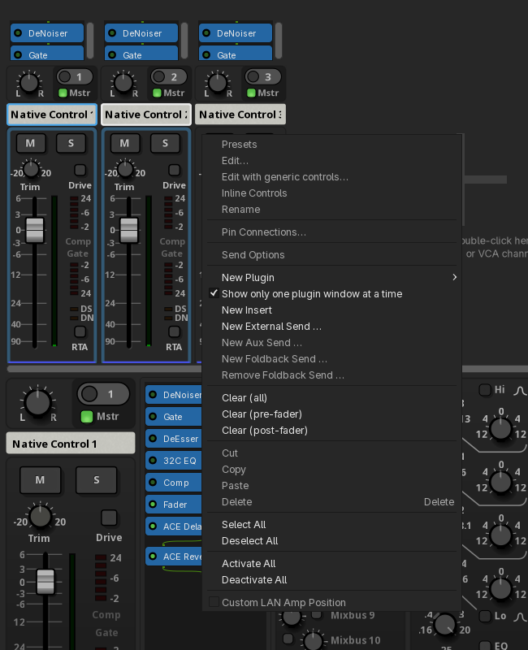
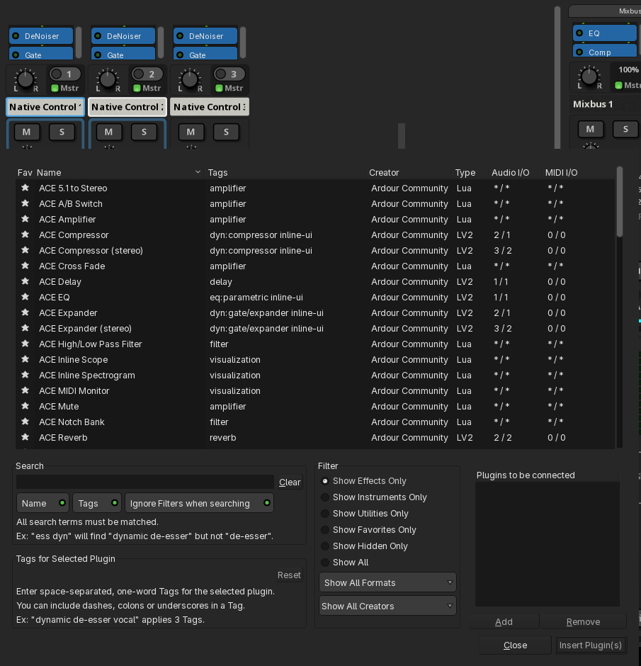
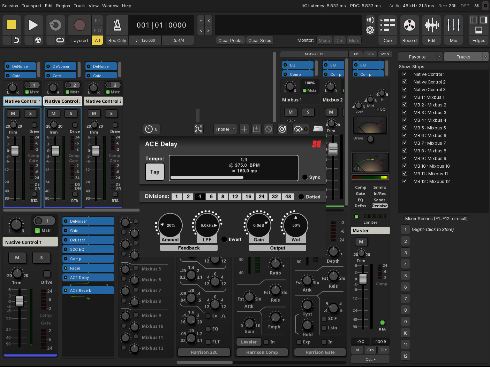
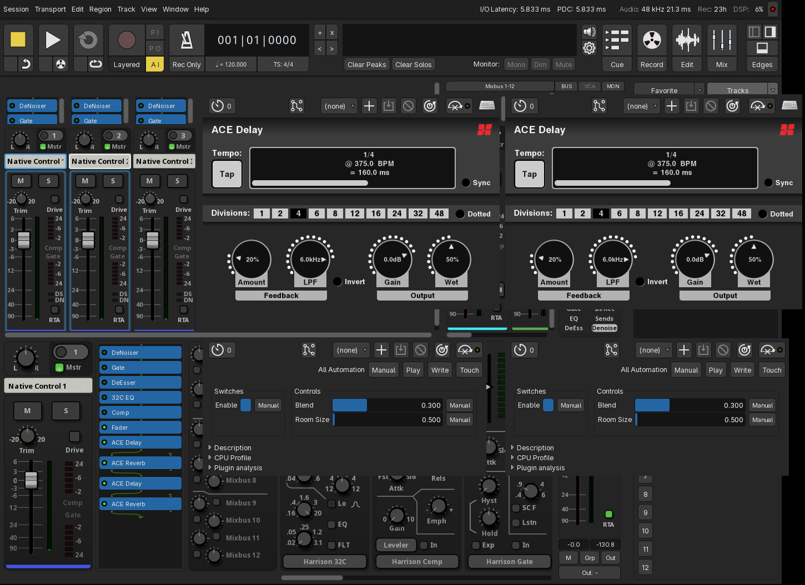

# Mixbus selected-channel workflow

Native changes for **Harrison Mixbus 12.1**: link compatible mixer controls, insert plugins and remove matching instances across selected channels.

This repository contains the **source patch, tests, documentation and screenshots**. It does not provide a ready-to-install application. This is an experimental, unofficial, AI-assisted contribution. Theme files, personal licenses and proprietary DSP binaries are not included.

## Behavior

| Action | Result |
| --- | --- |
| Adjust a compatible control | The corresponding controls on other selected channels receive the same value immediately. |
| Enable or disable EQ, Comp, Gate and other processors at the top of the mixer | Matching processors receive the same enabled state. |
| Enable or disable the Fader button | The main fader stages on selected channels receive the same state. |
| Click the processor list of an already selected channel | The multiple-channel selection is preserved, including when opening the plugin selector. |
| Add a plugin through the selector or drag it from plugins/favorites | An independent instance is inserted on each compatible selected channel. |
| Hover over a plugin entry and press Delete or Backspace | That instance and its matching occurrences on other selected channels are removed. No prior processor click is required. |
| Hold Shift for a supported linked operation | Only the originating channel is affected. |

Selection alone never copies settings. Unselected channels and Master/Monitor routes are excluded. Existing fader groups retain their relative behavior. The implicit selection groups/quick-group preference disables selection linking. Automation-controlled parameters are not forced by the link; parameter tests cover manual automation state `Off`.

## Open one editor or all editors

**Right-click the processor list → “Show only one plugin window at a time.”**

- **Checked:** only the first editable newly inserted instance opens.
- **Unchecked:** every newly inserted instance opens, including copies on other selected channels. Two plugins on two channels therefore produce four new editor windows.

This shares the existing **Preferences → Plugins/GUI** setting. The choice is saved and applies to subsequent openings. The general preference to open plugin GUIs automatically after insertion must also be enabled; otherwise no editors open automatically.

The menu uses standard Mixbus widgets and existing translations. Its language follows the user's Mixbus language. Each plugin's own interface retains its own localization. Repository documentation and screenshots are in English.



## Screenshots

These are actual captures of an isolated Linux verification session with three test tracks. The first two are selected; the third is an unselected control. Windows were arranged for screenshot readability; normal batch opening uses a small cascading offset. The local test profile's appearance is visible, but no theme files are distributed.

### Selection preserved

The plugin selector opens without reducing the selection to a single channel.



### Single-window mode

Two plugins are inserted on both selected channels, but only one editor opens.



### All-windows mode

All four new instance editors remain open. This test adds a second batch to the same channels; instances from the previous test remain in the chains with their editors closed.



## Compatibility and known limitations

- User plugins match by **format, exact unique ID and occurrence**, never merely by chain position. The second instance matches the second instance even if other processors appear between them.
- Mono/stereo variants and LV2/VST/VST3 formats with distinct identities are not automatically treated as the same plugin.
- Built-in controls, ACE parameters and selected custom **LV2** interfaces have been verified. This does not guarantee every third-party plugin or interface.
- Actual GUI coverage includes **XT-GV GVerb+** and **XT-DC Drum Character** graph/preset edits on identical mono instances. The failure reported in the user's own setup was not reproduced in the isolated test session.
- Custom VST/VST3 and AudioUnit editors are outside the current validation. Plugins may also use private properties, file loading or commands that do not represent ordinary parameters.
- Inserted copies configure their own IO. Sidechain port names and custom pin connections are not cloned. Incompatible insertion targets are reported. If no matching insertion anchor exists, the instance is appended.
- Hover deletion protects built-in channelstrip processors, faders and sends. It removes the corresponding occurrence, not every instance of that plugin type.
- Arbitrary Lua/API insertion and moves of existing processors between channels are not expanded across the selection.

## Get and apply the patch

Upstream sources: `git://git.ardour.org/harrison/mixbus`

Base tag: **`mixbus+12.1`**, base commit: **`3c365afcc0b029b29ea57e111e6845a509d04fef`**.

Exported feature commit: **`3574b119353396af85da3af0ae2da158aee39491`**.

Clone both repositories into the same parent directory:

```sh
git clone https://github.com/philhurtu99/mixbus-selected-controls.git
git clone --depth 1 --branch 'mixbus+12.1' git://git.ardour.org/harrison/mixbus mixbus-native
cd mixbus-native
git switch -c native-selected-channel-controls
git am ../mixbus-selected-controls/patches/mixbus-selected-controls.patch
```

If the upstream server is unavailable, obtain the matching sources from Harrison. Other source versions may require adaptation and retesting. Applying this patch changes source code, not an already installed application.

## Building and using the patch on a MacBook

Linux build dependencies must be installed first. The validated local procedure is documented in [IMPLEMENTATION.md](IMPLEMENTATION.md). After building, run **`./waf i18n_mo` before `./waf install`** to generate and install translation catalogs. Enabling NLS alone does not generate those catalogs.

On a MacBook, retrieve the same patch, then **build and package on macOS** for the correct architecture, Apple Silicon or Intel, using CoreAudio, macOS dependencies and the matching licensed Harrison macOS DSP obtained separately from an authorized installation. Upstream provides `tools/osx_packaging/osx_build`. Linux paths, executables and DSP binaries are not a Mac installer.

**macOS compilation and testing remain outstanding.** This repository contains no `.app`, `.dmg`, proprietary DSP or authorization token. Official updates do not automatically include this modification: the patch must be reapplied or ported and rebuilt unless Harrison integrates it upstream.

## Verification and proposing the contribution to Harrison

Linux integration tests cover **75 controls and 375 synchronous updates**, plugin identity/occurrence matching, quick groups, NoGroup override, target automation and deselection. Recorded GUI states cover processor toggles, custom LV2 editors, insertion/deletion, selection retention and both editor-opening modes. Preference persistence was checked after a clean application exit.

- [Tests and GUI observations](tests/selected-controls)
- [Implementation and local build notes](IMPLEMENTATION.md)
- [Developer review summary](docs/REVIEW.md)

To propose the contribution, contact [Harrison support](https://support.harrisonaudio.com/hc/en-gb/requests/new), provide this repository link and attach [the patch](patches/mixbus-selected-controls.patch), then ask for their preferred review process. No upstream acceptance is implied.

The patch modifies GPL-licensed source; original notices and [COPYING](COPYING) are retained. Screenshots illustrate application behavior and do not distribute its proprietary executable components.
